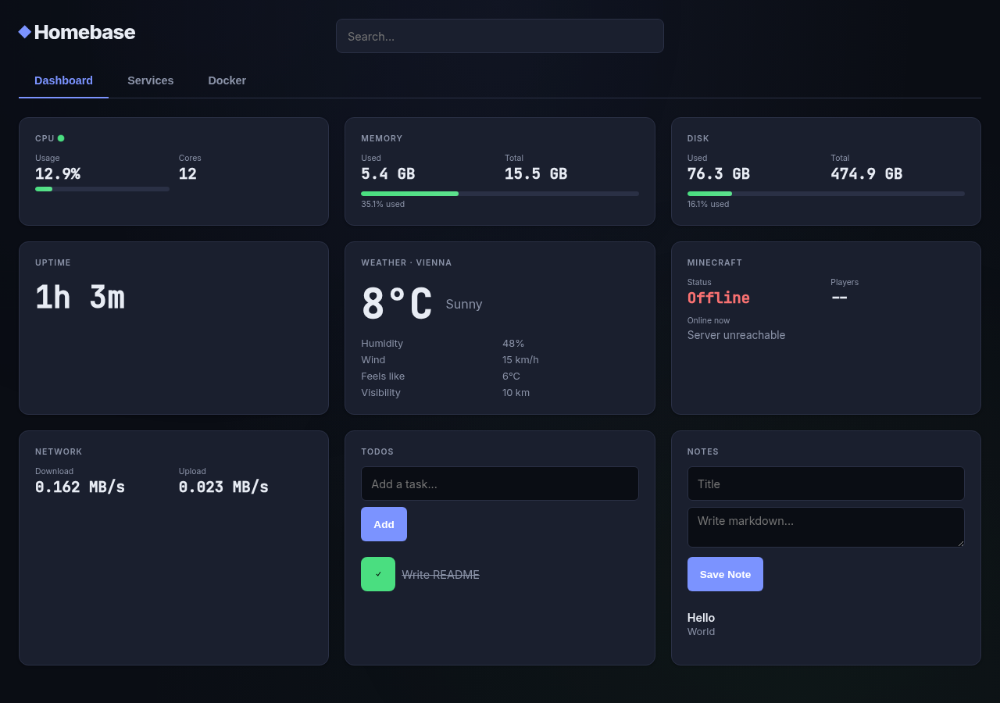

# Homebase

A self-hosted dashboard for my home server. It shows live system stats, weather, todos and notes,
and gives me one place to check on the services and Docker containers running on the machine.



## Features

- **Live system stats** – CPU, RAM, disk and uptime, pushed to the browser every 5 seconds over a WebSocket
- **Network speed** – current download/upload rate with a small sparkline
- **Weather** – current conditions for a configurable city via [wttr.in](https://wttr.in) (no API key needed)
- **Todos and notes** – simple CRUD, persisted to JSON files
- **Services overview** – health-checks every configured service and links to it, using the hostname you opened the dashboard with
- **Docker manager** – list containers and start / stop / restart them
- **Unified search** – one search box across git history, GitHub repos and other optional sources
- **Installable PWA** with a mobile layout (bottom navigation, swipe between tabs, pull-to-refresh)
- **Optional integrations** – Minecraft server status, a notification service and the dashboard for my short-form video tool. They stay hidden until you configure them.

## Tech stack

| Part | Technology |
|------|------------|
| Backend | Python, FastAPI, WebSockets, httpx, psutil |
| Frontend | Vanilla HTML / CSS / JavaScript, no build step |
| Storage | JSON files |
| Tests | pytest, pytest-asyncio |

## Getting started

Requires Python 3.10+.

```bash
git clone https://github.com/MinZziGOGOGO/homebase.git
cd homebase
python -m venv .venv && source .venv/bin/activate
pip install -r requirements.txt

uvicorn homebase.main:app --host 0.0.0.0 --port 8080
```

Then open `http://<server-ip>:8080`.

## Configuration

The dashboard works without any configuration. To change the city or add services and integrations,
copy the example config and edit it:

```bash
cp config.example.json config.json
```

| Key | Description |
|-----|-------------|
| `city` | Location for the weather widget |
| `services` | Cards on the Services tab (`name`, `url`, `icon`, `desc`) |
| `minecraft_server` | Address of a Minecraft server to show (`null` hides the card) |
| `docker` | Show the Docker tab (needs the `docker` CLI) |
| `shortform_dir` | Path to a shortform-ai checkout (`null` hides the Shorts tab) |
| `notifications_url` | Base URL of a notification service (`null` hides Alerts) |
| `search.*` | Optional search sources, e.g. `projects_dir` or `github_user` |

Environment variables: `HOMEBASE_CONFIG` (path to the config file) and `HOMEBASE_DATA_DIR`
(where todos and notes are stored, default `./data`).

> **Note:** Homebase has no login. It is meant for a home network or a VPN such as Tailscale.
> Don't expose it to the internet, since the Docker tab can start and stop containers.

## Running the tests

```bash
pip install -r requirements-dev.txt
pytest
```

The tests use a temporary data directory, so they never touch your real todos and notes.

## Project structure

```
homebase/
├── homebase/
│   ├── main.py        # FastAPI app: REST API, WebSocket, integrations
│   ├── config.py      # Loads config.json over the defaults
│   ├── stats.py       # System metrics via psutil
│   ├── storage.py     # JSON persistence for todos and notes
│   └── static/        # Single-page frontend, PWA manifest, service worker
├── tests/
├── config.example.json
└── requirements.txt
```

## API

| Method | Path | Description |
|--------|------|-------------|
| GET | `/api/config` | Enabled features for the frontend |
| GET / POST | `/api/todos` | List / create todos |
| PATCH | `/api/todos/{id}` | Set status (`todo`, `in_progress`, `done`) |
| DELETE | `/api/todos/{id}` | Delete a todo |
| GET / POST | `/api/notes` | List / create notes |
| DELETE | `/api/notes/{id}` | Delete a note |
| GET | `/api/weather` | Weather for the configured city |
| GET | `/api/network` | Current network throughput |
| GET | `/api/services` | Configured services with up/down status |
| GET | `/api/docker/containers` | Docker containers |
| POST | `/api/docker/containers/{name}/{start\|stop\|restart}` | Control a container |
| GET | `/api/search?q=` | Unified search |
| WS | `/ws/stats` | Live system stats |

Interactive API docs are available at `/docs` while the server is running.

## License

[MIT](LICENSE)
